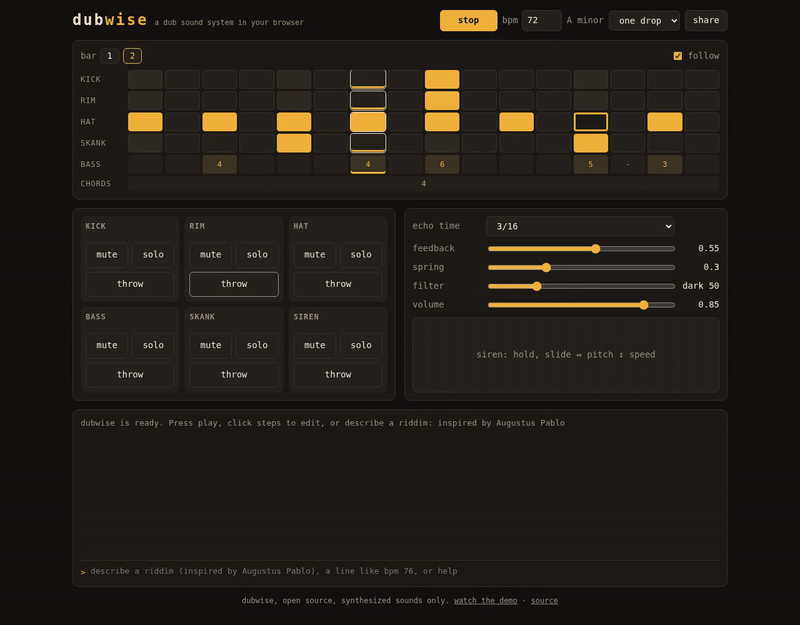

# dubwise

A dub sound system in your browser. Describe a riddim in your own words and it plays: synthesized drums and bass, a tape echo, a spring reverb, a siren, and a console you can live-code. No samples, no account, no install, no AI service, and it works offline.

**Play it: https://alb777.github.io/dubwise/**

[](https://alb777.github.io/dubwise/docs/demo.mp4)

**[Watch the 80 second demo with sound](https://alb777.github.io/dubwise/docs/demo.mp4)**, in the Ethiopia theme: a one drop, then six ideas typed into the console, `Iration Steppas meets King Tubby`, `a slow one drop for a rainy night`, `Natiruts na praia`, `un ritmo para bailar bajo la luna`, `furious robots in the factory` and `Damian Marley meets Lee Perry`, with throws, the siren, filter sweeps and a bass drop-out in between. Recorded from the real app, sound included.

## What you can do

1. **Play a riddim.** One drop, rockers or steppers to start, at dub tempo.
2. **Mix it like dub.** Mute channels in and out, hold **throw** to send a channel into the tape echo, sweep the DJ filter, ride the spring. The effect pads play the rest of a dub desk: kick the spring tank (**crash**), hold **spin** to send the echo into a howl, blow the air **horn**, switch on a **phaser** like the Mu-Tron Bi-Phase or a **low** or **high kill**, slow the riddim to a halt with **tape stop**, or **pull up**: rewind it and play it again from the top.
3. **Play the siren.** Hold the pad, slide sideways for pitch, up and down for speed.
4. **Edit the pattern.** Click steps in the grid; shift-click clears one.
5. **Live-code it.** Type `bpm 76` or `kick x...x...x...x...` in the console and the riddim changes on the next step.
6. **Share it.** The whole riddim lives in the link, so `share` copies a URL that plays exactly what you hear.
7. **Describe it.** Type an idea (`inspired by Augustus Pablo`, `a dark steppers in D minor`) and dubwise writes the riddim on your machine. Blend two names the dub way, `Iration Steppas meets King Tubby`: the first sets drums and tempo, the second the echo and bass. It also understands Portuguese and Spanish, so `um one drop lento com muito eco` works too. `again` gives another version, `undo` goes back. Then steer it: `darker`, `a bit faster`, `more echo`, `busier` or `mais lento` change the riddim playing and keep its bass line and key.
8. **Ask any AI.** `prompt <idea>` copies a prompt for any chat AI. Paste its answer back into the console and it plays.
9. **Learn it as you play.** The **guide** button (or `?`) opens a guide beside the app; its buttons run the real commands and point at the controls.
10. **Dress it in a flag.** The flag in the top right corner picks a theme: dub, Jamaica, Ethiopia, Brazil, South Africa, Great Britain, Trinidad & Tobago or Poland. Every theme is checked for readable text and visible buttons.
11. **Read the rest.** Words the lists miss, like `a volcano waking up` or `minha avó cozinhando num domingo`, go to dubwise's own word map, offline; names and films can go to an AI you choose under **✦ ai**. See [Reading what the word lists miss](#reading-what-the-word-lists-miss).

## The console

```
play, stop                start or stop the riddim
mute <ch>, unmute <ch>    channels: kick rim hat bass skank siren
solo <ch>, unsolo         hear one channel alone, or all again
throw <ch>                send a channel into the echo for one beat
filter <-1 to 1>          DJ filter: -1 dark, 0 open, 1 thin
crash, horn               kick the spring tank, blow the air horn
spin                      spin the echo into a howl for two beats (hold the pad for longer)
phaser, kill low|high     switch the phaser or a kill on and off
tape stop, pull up        slow the riddim to a halt, or rewind it and play it again from the top
preset <name>             one-drop, rockers, steppers
again, undo               another version of the last idea, or back one change
show, share, help, notation, clear
theme <name>              dub, jamaica, ethiopia, brazil, south-africa, britain, trinidad, poland
guide                     open the guide beside the app (or press ?)
ai                        choose an AI to read the ideas the word lists miss
ai <idea>, ai off         ask the AI even when every word is known, or turn it off
prompt <idea>             a prompt for any chat AI, built from your idea
<anything else>           an idea for the composer: inspired by King Tubby, steppers at 76 bpm...
```

Click a row name in the grid (for example **bass**) to pull that line into the console for editing.

## Riddim notation

A riddim is plain text, one setting per line. This is the one drop preset:

```
dubwise 1
bpm 72
key A minor
swing 0.15
kick   ........x....... | ........x.......
rim    ........x....... | ........x.......
hat    x.x.x.x.x.x.x.x. | x.x.x.x.x.x.o.x.
skank  ....x.......x... | ....x.......x...
chords 1 | 4
bass   . . 1 . . . 1 . 3 . . . 5 . 4 . | . . 4 . . . 4 . 6 . . . 5 - 3 .
echo   3/16 0.55
spring 0.3
```

Drums take 16 steps per bar (`.` rest, `x` hit, `X` accent, `o` open hat). The bass and the chords use scale degrees, so a riddim moves to any key with one line. Type `notation` in the console for the full reference, or read `SPEC` in [notation.mjs](skills/dubwise/scripts/notation.mjs).

## How ideas become riddims

The composer runs in the page, with no model and no network. It reads the idea for a style (one drop, rockers, steppers), a tempo (`80 bpm`, `slow`), a key (`in D minor`, `Gm`), a mood (dark, happy, lots of echo, minimal, melodic bass), images that suggest a feel (rain at night, a beach party, a march, a lullaby) and references, then writes drums, chords and a bass line that follow the rules of the style. Two names, as in `X meets Y`, split the work: the first sets drums and tempo, the second echo, bass and mood. The same idea always gives the same riddim, and `again` walks through other versions.

References cover more than a hundred artists, scenes and eras, from Studio One and King Tubby to UK steppers, lovers rock, dancehall, the reggae revival and reggae from Brazil, Africa, Poland and France. They map to broad style traits only, checked against public sources: King Tubby means heavy echo and channels dropping out, Jah Shaka means militant steppers. Plain words beat images, and images set the mood without taking a named artist's drums. dubwise holds no songs, so it never copies a real bassline or melody, and a name it does not know is said out loud instead of guessed at. No idea is turned down: words it does not know still pick a take, and the reply names them so you can steer with a style, mood or tempo. The `prompt` command asks the same of any chat AI you hand the idea to.

## Reading what the word lists miss

The word lists cover styles, moods, images and more than a hundred references, but not everything: a volcano, a grandmother, a film director. dubwise reads the rest in two ways.

**Its own word map, always on.** A table of word vectors from [potion-multilingual-128M](https://huggingface.co/minishlab/potion-multilingual-128M) (MIT), cut down to the letters of Portuguese, Spanish and English (`tools/build-lexicon.mjs`). No model runs: an unknown phrase is placed among the words the composer knows, and each trait (minor or major, slow or lively, sparse or busy, dry or wide echo) goes to the closer side when the gap is clear. It downloads once, 4 MB, the first time an idea needs it, answers in under a millisecond and works offline. It read 27 of 30 odd ideas the way a person would (`tests/lexicon.test.mjs`); names it reads loosely. The reply says `dubwise read "volcano waking up" as: minor, slow, sparse, wide echo`.

**An AI, if you pick one** under **✦ ai** (or the `ai` command), for names, films and nuance:

1. **In this browser.** An open model, Qwen3.5 (Apache-2.0), runs on your graphics card through [WebLLM](https://github.com/mlc-ai/web-llm). It downloads once (1.1 GB, or 0.45 GB for the lighter one) and then works offline, about 3 seconds an idea. It needs WebGPU on the graphics card: in Chrome or Brave on Linux, turn on both `chrome://flags/#enable-unsafe-webgpu` and `chrome://flags/#enable-vulkan`; without Vulkan WebGPU runs on the processor, which dubwise refuses as far too slow.
2. **Chrome's built-in model**, offered only when the browser has one.
3. **A server you choose**: Ollama or LM Studio on your computer, or an online service such as Groq, OpenRouter or Gemini with your own key. Ollama has to let the page in: `OLLAMA_ORIGINS=https://alb777.github.io ollama serve`. LM Studio needs CORS turned on.

The AI never writes notes. It fills a small form (a few words on how it read the idea, then style, tempo, mood, echo, density and bass) and dubwise checks every value. Its words count more than its picks: a small model describes an idea well (`2pac: iconic, gritty, revolutionary`) but leans to major and to its worked examples when it picks, so the word lists and the word map turn its words into settings first, and its picks fill only what the words leave open. The composer uses the result only where the idea's own words and the artists it knows leave a gap. It is only asked about the words dubwise does not know, or the whole idea when you type `ai <idea>`. If it fails, the word map reads the idea instead. Nothing is sent anywhere until you pick a provider; a key stays in the tab and is forgotten when it closes.

## Offline

Open the page once and it keeps working without a connection. Browsers that support it offer to install it as an app.

## Development

No build step and no runtime dependencies: the app is plain JavaScript modules served as they are. The one exception is opt-in: the in-browser AI loads WebLLM, pinned to an exact version, from jsDelivr when the player turns it on. The dev tools are for testing only.

```bash
npm install
npm test                # notation, sequencer, console, and offline audio renders measured with node-web-audio-api
npm run check           # TypeScript strict checking of the JSDoc types, and Biome
npm run check:browser   # audio and UI checks in a headless Chromium browser (BROWSER=chromium to pick one)
npm run check:ai        # the in-browser AI on your GPU over odd ideas; downloads the model (1.1 GB) once
npm run build:lexicon   # rebuild the word map from potion-multilingual-128M (512 MB download, once), then npm run sw:version
npm run build:references # rebuild the artist and riddim catalogue from its source, kept outside this repository
python3 -m http.server  # then open http://localhost:8000
```

## License

MIT. Every sound is synthesized in code; dubwise ships no samples and is not affiliated with any instrument maker.
