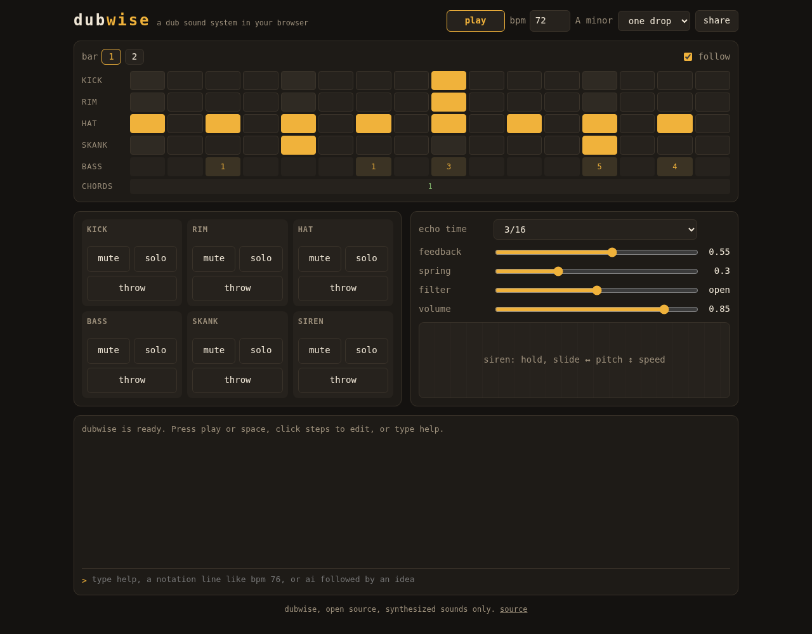

# dubwise

A dub sound system in your browser. Describe a riddim in your own words and it plays: synthesized drums and bass, a tape echo, a spring reverb, a siren, and a console you can live-code. No samples, no account, no install, no AI service, and it works offline.

**Play it: https://alb777.github.io/dubwise/**



## What you can do

1. **Play a riddim.** One drop, rockers or steppers to start, at dub tempo.
2. **Mix it like dub.** Mute channels in and out, hold **throw** to send a channel into the tape echo, sweep the DJ filter, ride the spring.
3. **Play the siren.** Hold the pad, slide sideways for pitch, up and down for speed.
4. **Edit the pattern.** Click steps in the grid; shift-click clears one.
5. **Live-code it.** Type `bpm 76` or `kick x...x...x...x...` in the console and the riddim changes on the next step.
6. **Share it.** The whole riddim lives in the link, so `share` copies a URL that plays exactly what you hear.
7. **Describe it.** Type an idea in English, Portuguese or Spanish (`inspired by Augustus Pablo`, `a dark steppers in D minor`, `um one drop lento com muito eco`) and dubwise writes the riddim on your machine. `again` gives another version, `undo` goes back.
8. **Ask any AI.** `prompt <idea>` copies a prompt for any chat AI. Paste its answer back into the console and it plays.

## The console

```
play, stop                start or stop the riddim
mute <ch>, unmute <ch>    channels: kick rim hat bass skank siren
solo <ch>, unsolo         hear one channel alone, or all again
throw <ch>                send a channel into the echo for one beat
filter <-1 to 1>          DJ filter: -1 dark, 0 open, 1 thin
preset <name>             one-drop, rockers, steppers
again, undo               another version of the last idea, or back one change
show, share, help, notation, clear
prompt <idea>             a prompt for any chat AI, built from your idea
<anything else>           an idea for the composer: inspired by King Tubby, steppers at 76 bpm...
```

Click a row name in the grid (for example **bass**) to pull that line into the console for editing.

## Riddim notation

A riddim is plain text, one setting per line. This is the one drop preset:

```
dubwise 1
bpm 72
key A minor
swing 0.15
kick   ........x....... | ........x.......
rim    ........x....... | ........x.......
hat    x.x.x.x.x.x.x.x. | x.x.x.x.x.x.o.x.
skank  ....x.......x... | ....x.......x...
chords 1 | 4
bass   . . 1 . . . 1 . 3 . . . 5 . 4 . | . . 4 . . . 4 . 6 . . . 5 - 3 .
echo   3/16 0.55
spring 0.3
```

Drums take 16 steps per bar (`.` rest, `x` hit, `X` accent, `o` open hat). The bass and the chords use scale degrees, so a riddim moves to any key with one line. Type `notation` in the console for the full reference, or read `SPEC` in [notation.mjs](skills/dubwise/scripts/notation.mjs).

## How ideas become riddims

The composer runs in the page, with no model and no network. It reads the idea for a style (one drop, rockers, steppers), a tempo (`80 bpm`, `lento`), a key (`in D minor`, `em Ré menor`), a mood (dark, happy, lots of echo, minimal, melodic bass) and artist or scene references, then writes drums, chords and a bass line that follow the rules of the style. The same idea always gives the same riddim, and `again` walks through other versions.

Artist references map to broad style traits only: King Tubby means heavy echo and channels dropping out, Jah Shaka means militant steppers. dubwise holds no songs, so it never copies a real bassline or melody, and a name it does not know is said out loud instead of guessed at. The `prompt` command asks the same of any chat AI you hand the idea to.

## Offline

Open the page once and it keeps working without a connection. Browsers that support it offer to install it as an app.

## Development

No build step and no runtime dependencies: the app is plain JavaScript modules served as they are. The dev tools are for testing only.

```bash
npm install
npm test                # notation, sequencer, console, and offline audio renders measured with node-web-audio-api
npm run check           # TypeScript strict checking of the JSDoc types, and Biome
npm run check:browser   # audio and UI checks in a headless Chromium browser (BROWSER=chromium to pick one)
python3 -m http.server  # then open http://localhost:8000
```

## License

MIT. Every sound is synthesized in code; dubwise ships no samples and is not affiliated with any instrument maker.
